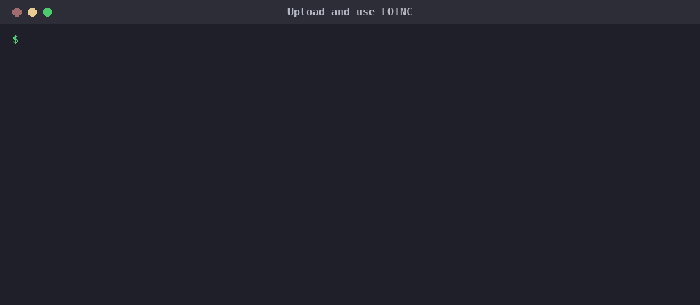
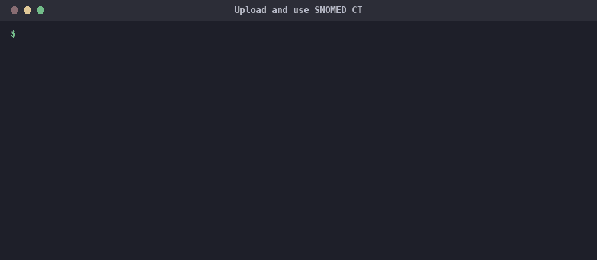
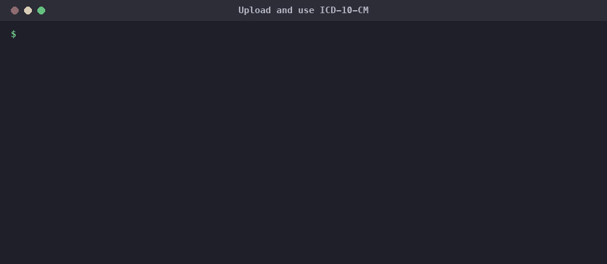
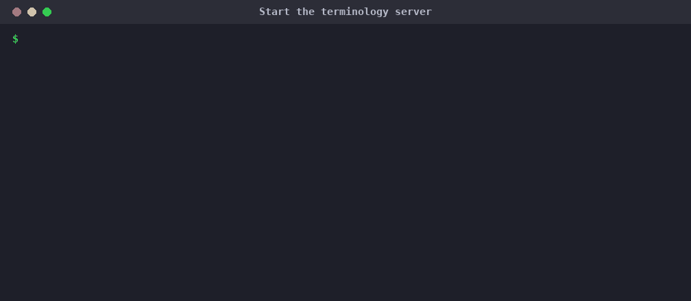

# Ballerina FHIR Terminology Service

This project implements a FHIR R4 Terminology Service in Ballerina, providing RESTful APIs for managing and querying FHIR ValueSets and CodeSystems. It is designed to be compatible with HL7 FHIR R4 standards and supports key terminology operations such as expansion, validation, lookup, and subsumption.

## Features

- **ValueSet Operations**: Expand, validate, search, create, and retrieve ValueSets.
- **CodeSystem Operations**: Lookup, validate, subsume, search, create, and retrieve CodeSystems.
- **ConceptMap Operations**: Translate, search, create, and retrieve ConceptMaps.
- **Closure Table**: Maintain a client-named, incrementally-growing subsumption table via `$closure`.
- **Batch Validation**: Validate multiple ValueSets in a single request.
- **Upload**: Upload terminology resources in bulk.
- **Find Code**: Search for codes across CodeSystems and ValueSets.
- **FHIR CapabilityStatement**: Exposes service metadata for FHIR clients.

## API Endpoints

The service exposes the following main endpoints under `/fhir/r4`:

### ValueSet

- `GET /ValueSet/$expand` — Expand a ValueSet.
- `POST /ValueSet/$expand` — Expand a ValueSet with a POST body.
  - `ValueSet.compose.include.filter` supports `is-a` / `descendent-of`, `=`, and `regex`. Multiple filters on the same `include` are combined with AND (each narrows the same member set further), while multiple `include` entries are combined with OR.
  - `activeOnly=true` drops inactive concepts from the expansion and recomputes `expansion.total`.

- `GET /ValueSet/$validate-code` — Validate a code against a ValueSet.
- `POST /ValueSet/$validate-code` — Validate a code with a POST body.
  - Accepts either a `url` referencing an already-persisted ValueSet, or an inline `valueSet` resource in the request body — including one that was never separately uploaded.
- `GET /ValueSet/{id}/$expand` — Expand a ValueSet by ID.
- `GET /ValueSet/{id}/$validate-code` — Validate a code by ValueSet ID.
- `GET /ValueSet/{id}` — Retrieve a ValueSet by ID.
- `GET /ValueSet` — Search ValueSets.
- `POST /ValueSet` — Create a new ValueSet. `version` is optional, per the FHIR spec.

### CodeSystem

- `GET /CodeSystem/$lookup` — Lookup a code in a CodeSystem.
  - Returns one `parent` property per direct is-a parent (a concept can have more than one — e.g. SNOMED) and one `child` property per direct child, for CodeSystems that store hierarchy, along with the `abstract` and `inactive` flags derived from concept properties.
  - For SNOMED, also returns non-is-a clinical attribute relationships (e.g. Finding site, Associated morphology) as `property` entries, resolved from the imported Relationship data.

- `POST /CodeSystem/$lookup` — Lookup with a POST body.

- `GET /CodeSystem/$validate-code` — Validate a code against a CodeSystem.
- `POST /CodeSystem/$validate-code` — Validate a code with a POST body.
  - Accepts a `coding`, `codeableConcept`, or `code` (+`url`), validated against either a `url` referencing an already-persisted CodeSystem or an inline `codeSystem` resource in the request body — including one that was never separately uploaded.
  - A supplied `display` is checked against the matched concept's display and designations (synonyms count as a match); a mismatch returns `result: false` with a `message` explaining why.
- `GET /CodeSystem/$subsumes` — Test subsumption relationships.
- `POST /CodeSystem/$subsumes` — Test subsumption with a POST body.
- `GET /CodeSystem/{id}/$lookup` — Lookup by CodeSystem ID.
- `GET /CodeSystem/{id}/$validate-code` — Validate a code by CodeSystem ID.
- `GET /CodeSystem/{id}` — Retrieve a CodeSystem by ID.
- `GET /CodeSystem` — Search CodeSystems.
- `POST /CodeSystem` — Create a new CodeSystem. `version` is optional, per the FHIR spec.

### ConceptMap

- `GET /ConceptMap/$translate` — Translate a code from a source ValueSet to a target ValueSet.
- `POST /ConceptMap/$translate` — Translate with a POST body.
- `GET /ConceptMap/{id}` — Retrieve a ConceptMap by ID.
- `GET /ConceptMap` — Search ConceptMaps.
- `POST /ConceptMap` — Create a new ConceptMap.

### Other Operations

- `POST /` — Batch validate ValueSets.
- `POST /%24upload`\* — Upload terminology resources as a zip. See [Uploading Terminology Content](#uploading-terminology-content).
- `POST /$closure` — [ConceptMap/$closure](https://hl7.org/fhir/R4/conceptmap-operation-closure.html): maintain a client-named, incrementally-growing subsumption closure table. Each call adds the given `concept`s to the named table (`name` parameter) and returns only the subsumption pairs not yet reported for that name. Pass a previously-returned `version` to resync everything reported since that version.
- `GET /$find-code` — Find codes.
- `POST /$find-code` — Find codes with a POST body.
- `GET /metadata` — Get the FHIR CapabilityStatement.

\* `$upload` must currently be called with the `$` percent-encoded (`%24upload`) - a bug in the pinned Ballerina http module (2.14.13) 404s on a raw `$` in the path for this endpoint. This will go away once the Ballerina distribution is upgraded past that bug.

## Search Pagination

`GET /ValueSet`, `GET /CodeSystem` and `GET /ConceptMap` are paginated with `_count` (page size) and `page` (1-based page number):

```sh
curl "http://localhost:9090/fhir/r4/CodeSystem?status=active&_count=20&page=2"
```

Search filters are combined with AND. `Bundle.total` is the number of matches across all pages, and `_count=0` returns only the total. The Bundle carries `self`, `next` and `prev` links, which keep the request's filters; `next` is omitted on the last page. Without `_count`, the page size is `search_page_size` (default 100), which is also the largest `_count` honoured:

```toml
[wso2.terminology_service]
search_page_size = 100
```

## Built-in FHIR CodeSystems

On startup the service loads the CodeSystems bundled with the FHIR terminology library into the database: the FHIR R4 CodeSystems (`http://hl7.org/fhir/...`) and the HL7 Terminology (THO) CodeSystems (`http://terminology.hl7.org/CodeSystem/...`), about 500 in all. CodeSystems already stored with the same url and version are left untouched, so this only does work on the first start against an empty database (about 15 seconds) and adds about a second to later starts. To turn it off:

```toml
[wso2.terminology_service]
load_default_code_systems = false
```

## Uploading Terminology Content

`POST /%24upload` (see footnote above) accepts a zip archive. Two things are required on the request:

- `Content-Type: application/zip`
- `x-terminology-type` header, set to `FHIR`, `LOINC`, `SNOMED`, or `ICD10`

The header selects how the archive is interpreted. A missing or unrecognised value returns `400`.

```sh
export TX=http://localhost:9090/fhir/r4
curl -X POST "$TX/%24upload?loinc-version=2.80" \
  -H "Content-Type: application/zip" -H "x-terminology-type: LOINC" \
  --data-binary @Loinc_2.80.zip
```

The recordings below were made against the 1.0.0 release, using small sample files from the test suite; real releases take longer to load.

### FHIR

Expects a zip of FHIR `CodeSystem-*.json` and `ValueSet-*.json` files. Loaded synchronously.

### LOINC

Expects a LOINC release zip. Converted to a FHIR CodeSystem and loaded synchronously.

- `loinc-version` (query parameter, optional) — version to record on the CodeSystem.



### SNOMED CT

Expects a SNOMED CT RF2 Snapshot release zip, containing the Concept, Description, Relationship and (optionally) Text Definition files.

- `snomed-version` (query parameter, optional) — RF2 release date as `YYYYMMDD`, recorded as the CodeSystem version.



### ICD-10-CM

Expects a zip of the ICD-10-CM release files: the tabular XML (`icd10cm-tabular-<year>.xml`, for chapters and sections) and the order file (`icd10cm-order-<year>.txt`, for codes and descriptions). Files may be nested in subdirectories. Imported asynchronously, same as SNOMED CT.

- `icd10cm-version` (query parameter, optional) — version to record on the CodeSystem.
- CodeSystem url: `http://hl7.org/fhir/sid/icd-10-cm`.
- Only one ICD-10-CM import may run at a time (independent of the SNOMED CT single-flight guard); a concurrent request returns `409`.
- Codes use the dotted FHIR form, e.g. `E11.9`.



**SNOMED CT and ICD-10-CM imports run in the background.** The request returns `201 Created` as soon as the archive is extracted, before the concepts are loaded. A full release takes several minutes; check the server logs for progress and for the completion summary.

For SNOMED CT and ICD-10-CM, re-uploading the same url and version replaces the previous load rather than duplicating it, and if the import fails partway, the partial load is removed. FHIR and LOINC uploads do not replace a CodeSystem that is already stored with the same url and version.

Concept hierarchy is stored in the `concept_closure` table as a transitive is-a closure, which supports `$subsumes` and the `is-a` / `descendent-of` filters on `$expand`.

## Usage

1. **Start the Service**: Run the Ballerina service (see below).
2. **Interact with the API**: Use tools like Postman or curl to send FHIR-compliant requests to the endpoints.
3. **Test Data**: Sample ValueSets, CodeSystems, and test payloads are available in the `tests/resources` directory.

## Running the Service

The quickest way is the release zip (see [Releases](#releases)), which needs only Java 21+:



To run from source instead, ensure you have [Ballerina](https://ballerina.io/downloads/) installed. Then run:

```sh
bal run service.bal
```

The service will start on port `9090` by default.

## Releases

Each release ships `terminology-service-<version>.zip`, attached to its GitHub Release. The zip contains the jar, `server.sh`/`server.bat`, a ready-to-run `Config.toml`, an empty H2 database with the schema already created, and the H2/PostgreSQL schema scripts. Unzip it and run `./server.sh` (needs Java 21+).

To cut a release:

1. Set `version` in `Ballerina.toml` (and the matching `wso2/terminology_service` entry in `Dependencies.toml`), then merge.
2. Push a tag `terminology-service-v<version>`, e.g. `terminology-service-v1.0.0`. The tag must match `Ballerina.toml`.

The [release workflow](../../.github/workflows/release-terminology-service.yml) builds the zip, tests it, starts the packaged server for a smoke test, and publishes the release. Running the workflow manually builds the zip as a workflow artifact without publishing a release.

To build the zip locally: `bal build && distribution/package.sh <version>` (output goes to `target/release/`).

The version reported in the TerminologyCapabilities statement (`GET /metadata?mode=terminology`) comes from the `service_version` config value. The packaging step sets it to the release version in the shipped `Config.toml`, so it never needs editing by hand; builds run any other way report `dev`.

## Project Structure

- `service.bal` — Main service implementation.
- `types.bal`, `utils.bal`, `data_mapping.bal`, etc. — Supporting modules and utilities.
- `modules/` — Contains submodules for LOINC, SNOMED, ICD-10-CM, and persistence.
- `tests/` — Test cases and sample resources.

## Supported DB Types and Configurations

> **Upgrading a database created before 1.0.0:** concept `display` and `definition` used to be limited to 191 characters, and concepts with longer text were silently dropped when a CodeSystem was loaded through `POST /CodeSystem` or a FHIR or LOINC `$upload`. Those CodeSystems, and any stored ValueSets that include them, are incomplete. They cannot be repaired in place: re-posting or re-uploading the same url and version is rejected or ignored, and stored ValueSets link to a CodeSystem's internal row ids, so deleting and re-adding it by hand would break them. (SNOMED CT and ICD-10-CM imports and the built-in CodeSystems are not affected; they never keep a partial load.)
>
> The supported upgrade is to recreate the database from the 1.0.0 schema and reload your content:
>
> 1. Stop the service and back up the database.
> 2. Recreate the schema (this deletes all stored content):
>    - **H2** (from the release directory): delete `database/terminology.mv.db`, then run
>      `java -cp terminology_service.jar org.h2.tools.RunScript -url "jdbc:h2:./database/terminology" -user sa -script dbscripts/h2.sql`
>    - **PostgreSQL**: drop and recreate the database, then run `psql -d <database> -f dbscripts/postgresql.sql`
> 3. Start the service. The built-in FHIR CodeSystems are loaded automatically.
> 4. Re-load your own content: CodeSystems first (`POST /CodeSystem` or `$upload`), then the ValueSets and ConceptMaps that use them.
> 5. Rebuild any `$closure` tables. Recreating the database deletes every named closure table, and the server cannot tell a client this happened: a call with an existing table name silently starts a new, empty table whose versions count from 1 again, and a resync with an earlier `version` returns no pairs. So before the rebuild, each client should keep the concepts it has submitted to each named table. After step 4, it should discard its previous closure results and versions for those tables, then submit the kept concepts again to rebuild them.
>
> If the database never had CodeSystems loaded through `POST /CodeSystem` or a FHIR or LOINC `$upload` (for example, it only holds SNOMED CT or ICD-10-CM imports), nothing was lost, and you can upgrade in place instead:
>
> ```sql
> -- PostgreSQL
> DROP INDEX IF EXISTS "idx_concepts_display";
> ALTER TABLE "concepts" ALTER COLUMN "display" TYPE TEXT, ALTER COLUMN "definition" TYPE TEXT;
> -- H2
> DROP INDEX IF EXISTS "idx_concepts_display";
> ALTER TABLE "concepts" ALTER COLUMN "display" SET DATA TYPE VARCHAR;
> ALTER TABLE "concepts" ALTER COLUMN "definition" SET DATA TYPE VARCHAR;
> ```

The following DB types are supported. 

- H2

```toml
[wso2.terminology_service]
db_type = "h2"
```
```toml
# When db_type is h2, use the following configuration values to connect to the database. Make sure to update the values accordingly.
[wso2.terminology_service.store_h2]
url = "database url"
user = "database user"
password = "database password"
```

- PostgreSQL

```toml
[wso2.terminology_service]
db_type = "postgresql" 
```
```toml
# When db_type is postgresql, use the following configuration values to connect to the database. Make sure to update the values accordingly.
[wso2.terminology_service.store_pg]
host = "database host"
database = "database name"
user = "database user name"
password = "database password"
port = 5432
```

## Conformance Test Suite

This service targets conformance with the HL7 FHIR Terminology Ecosystem IG's
test suite. See [tests/conformance-test-suite.md](tests/conformance-test-suite.md)
for how to point the suite at a running instance of this service and run it.

## References

- [HL7 FHIR Terminology Service Specification](https://hl7.org/fhir/terminology-service.html)
- [Ballerina FHIR Module](https://central.ballerina.io/ballerinax/health.fhir.r4)

## License

This project is licensed under the Apache License 2.0.

